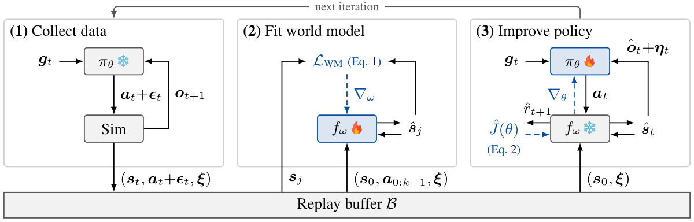
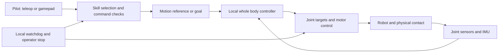

# European Robot Fighting League

This repository describes how we would build a humanoid fighting league around Unitree G1 robots, and gives developers a starting point for the control, training and deployment work.

The experience we want is straightforward: a pilot uses a gamepad to move, guard and request a skill, while the robot handles its own balance and execution. A punch should remain useful when it meets an opponent, misses its target or is interrupted. After losing balance, the robot should have a defined path back to a controllable state. The same commands should let a developer practice in simulation and later operate a qualified physical robot.

Getting there requires more than a library of convincing motions. We need a controller that can execute them, training that includes their physical consequences, and an interface that only requests actions the robot can currently perform. This guide follows that progression, starting with one working G1 and ending with two robots sharing an arena.

It is a proposed development approach with links to existing work. The research results belong to their authors; this repository does not yet contain a trained fighting controller. SuperMimic and the additional media were reviewed on 23 October 2026.

## What a match asks of the robot

REK is a useful place to see the intended experience. Its engineering collaborator describes human pilots choosing actions while learned control maintains balance, with a simulator used for practice. That gives us an interface precedent and an operational example. It does not disclose a complete training recipe for our controller. [REK engineering account](https://reflexarc.co.uk/projects/rek-robots)

*REK0 event recording, published by REK and linked by Reflex Arc. Select the image to watch physical robot fights. This is event footage, not a demonstration of a policy trained by this repository.*

Consider one exchange. The pilot moves into range and requests a punch. The robot shifts its weight, extends the arm, makes contact and returns to guard. If the opponent steps away, the arm still needs to stop without pulling the robot over. If the opponent pushes back, the feet and torso need to respond. A second button press during that sequence needs a clear meaning: queue a move, cancel at an allowed point, or reject the request.

That exchange connects almost every technical decision below. Motion data describes the intended movement. The controller turns it into joint commands. Contact training teaches useful responses when the movement cannot unfold exactly as recorded. The skill interface coordinates entry, execution and recovery. Match software decides whether anything scored.

## Establish the first G1 baseline

Start with the actual robot configuration and its supported development interface. NVIDIA's released SONIC controllers target a 29 degree of freedom G1 configuration. Joint layout, actuator settings and observation configuration must match the chosen checkpoint. Treat the model, encoder, decoder, preprocessing and control gains as one versioned package. [SONIC implementation and deployment](https://github.com/NVlabs/GR00T-WholeBodyControl)

The first useful result is a robot that repeatedly stands, walks, turns and executes a small set of reference motions. Reproduce those behaviors in simulation, then on one robot in a controlled test area. Record both successful and failed attempts, along with sensor inputs, policy outputs and commanded joint targets. This gives later changes a baseline to improve upon and a way to explain regressions.

Whole body control matters even for a simple arm movement. Reaching forward changes the load on the legs and the motion of the torso. A tracking policy observes the robot and continuously adjusts its action while following a reference. The reference expresses what we want to do; the feedback loop determines how to do it from the current state.

*SONIC method overview, NVIDIA and the SONIC authors. Different forms of motion intent connect to a shared control decoder. [Paper and project](https://nvlabs.github.io/GEAR-SONIC/).*

Teleoperation is useful at this stage. It lets us explore the controller, collect demonstrations and see where its operating range ends. Keep the balance loop on the robot; headset tracking and network delivery supply intent. Test tracking loss and command expiry before relying on teleoperation for a demonstration.

## Choose between adapting and training from scratch

There are two development paths. A working SONIC checkpoint gives us a nominal controller to adapt. Training a tracker from scratch gives us ownership of its data, observations and optimization, which can be valuable when the required behavior differs substantially from the released baseline. Both paths eventually need the same contact and deployment evaluation.

[SuperMimic](https://supermimic.github.io/) makes the second path particularly relevant. It learns a dynamics model from simulator transitions and improves the tracking policy through that model. The model and policy develop together; policy gradients pass through the learned model, not the physics simulator. [Paper, Section 3](https://arxiv.org/abs/2610.28480)

*Training-loop diagram from Figure 2 of Liao et al., SuperMimic. Cropped from page 4; attribution and extraction details are in [media sources](assets/README.md).*

The authors report exceeding the released SONIC checkpoint's normalized return after three hours on one H100. Their comparison uses different hardware and training data. The reported zero failures after 9.8 hours on two GPUs concerns coverage of the evaluated training motions, rather than unseen opponents or physical fights. [Results and benchmark conditions](https://supermimic.github.io/#compute)

For the league, the opportunity is to make controller experiments affordable enough to repeat. We could compare motion sets, observation choices and contact curricula instead of committing every available GPU hour to one large run. Those experiments still need measured costs and independent evaluation; the paper's runtime is not a quote for a fighting policy.

We would keep the reproduced SONIC baseline while developing a smaller scratch-training experiment. First establish that our data and environment can train a few useful motions. Then investigate a learned dynamics model as a way to expand coverage. The [training from scratch guide](docs/from_scratch.md) separates the available starting points from the integration work required.

## Build a motion library around usable skills

A league needs a modest, reliable vocabulary before it needs a large repertoire. Begin with stance, guard, stepping, turning and recovery. Add one punch, then a kick, with a stable start and finish. Jumping comes later because takeoff, landing and interruption each introduce additional states that need testing.

Use existing robot references or recorded teleoperation where possible. For a movement available only on video, a practical route is **GVHMR → GMR or UMR → validated robot references → simulation training**. GVHMR recovers human motion; retargeting maps it onto the robot. UMR is the method based on learned point cloud correspondence. The [motion preparation guide](docs/motions.md) covers the checks between those stages.

*Robo Jab team's published simulation GIF. The solid robot executes a learned jab and the ghost shows the reference. This illustrates motion tracking before an opponent is introduced. [Project and pipeline](https://github.com/abtonmoy/ai_hackathon_calhacks).*

For each skill, retain the approach and return to stance instead of extracting only the most distinctive frame. Check foot sliding, root drift, joint limits, self collision and target placement. Preserve source clips and processing settings so a bad reference can be traced back to reconstruction or retargeting.

The output is still a movement proposal. Video does not measure impact forces, and a geometrically valid robot pose does not establish that the robot can reach it dynamically. That is where simulation training begins.

## Turn motion tracking into contact behavior

Take the jab above and place a padded target in its path. The reference continues forward, but contact prevents the hand from following it. If training only rewards closeness to the reference, the controller may persist with a movement that now compromises balance. We need the task to recognize that contact changes what successful execution means.

Start with a stationary target and a narrow range of initial conditions. Vary its position, mass and compliance as the skill becomes reliable. Include misses, early contact, blocked arms and disturbances to the torso. Evaluate whether the robot reaches an allowed target, remains within actuator limits and returns to a state from which the next command can start. Raw impact magnitude is a poor substitute for those outcomes.

A tracker is already reactive to its observations. The missing piece is experience with the interactions we expect it to handle. The policy needs some freedom to depart from the reference, while rewards and termination rules make that departure useful. Otherwise we can produce attractive rehearsal footage without a dependable contact skill.

Separate fall prevention, controlled descent and getting up. A policy trained only from upright states, with every fall ending the episode, has little opportunity to learn what to do on the floor. Recovery training needs representative fallen states and enough time to complete the behavior.

*Method overview from Cheng et al., GigaBrain WBC 0.5. Its treatment of feasible commands and recovery informs this design. [Project and paper](https://shepherd1226.github.io/gigabrain-wbc-0.5/).*

GigaBrain is a separate controller architecture, not a SONIC LoRA recipe. Its recovery percentage is a simulation result, with hardware demonstrations providing separate evidence. The design lesson for this league is to condition execution on the robot's current capabilities and train the transitions back to useful states.

## Specialize the controller with LoRA

Once the nominal controller works, LoRA is one candidate for adapting it to our robot configuration and contact curriculum. It freezes the base weights and trains small weight updates. This can make experiments easier to store and compare, while leaving the established command interface available.

[TRACE on Unitree H2](https://github.com/QinnyuLan/SONIC_unitree_h2) and [SONIC transfer to AgiBot X2](https://sonic-agibot-x2.github.io/sonic-transfer/) provide concrete embodiment-transfer examples. They motivate decoder adaptation; they do not establish that a G1 becomes robust to fights simply by attaching an adapter. [Adaptation methods and release boundaries](docs/training.md)

Our first experiment would retain nominal motions in the training mixture while adding target contact and disturbances. Compare the adapter against the original checkpoint and a full fine tuning control using the same evaluation cases. An improvement in punch completion is useful only if standing, walking and recovery remain acceptable.

Keep the first implementation simple: one adapted controller serving several skills. A separate adapter for every move introduces switching behavior that also needs qualification. Fewer trainable weights can reduce optimization and storage costs, but simulation and base-network inference still consume compute. Measure GPU hours to the required result rather than predicting savings from parameter count alone.

## Make skills accessible from a gamepad

The pilot should choose tactics while the robot manages execution. For the initial league format, the pilot also supplies opponent awareness; proprioception alone does not tell the robot where its opponent is. Autonomous targeting would add a perception and state-estimation problem.

A skill needs entry conditions, an execution goal, interruption points and a stable exit. If the robot is recovering from a kick, another kick request might be rejected while a guard request is queued. Make those decisions visible to the pilot through acknowledgements. A button press must not silently mean something different depending on network timing.

| Pilot input | Proposed command |
| --- | --- |
| Left stick | Translation within the tested locomotion range |
| Right stick | Heading |
| Face buttons | Request a tested punch or kick |
| Shoulder button | Guard or cancel where the active skill permits it |
| Dedicated stop | Independent operator stop |

These are proposed league commands, not SONIC defaults. Teleoperation remains useful for demonstrations and data collection. The gamepad becomes the competition interface once skills and transitions work, reducing the need to transmit a continuous human pose. Both interfaces still require latency measurement, stale-command rejection and a tested response to connection loss.

## Train in a calibrated simulation

We recommend mjlab with MuJoCo Warp for the league's training environment. It provides a practical base for GPU experiments with explicit robot models and configurable contacts. Calibrate friction, padding, actuator response and delay against measurements from the actual robot. A simulator's name alone does not establish better contact accuracy than PhysX. [mjlab design](https://mujocolab.github.io/mjlab/v1.6.0/source/motivation.html)

There is integration work between the research components. SONIC's released training pipeline uses Isaac Lab. mjlab's existing G1 tracking task is a useful independent baseline, but its policy is not a SONIC checkpoint. Likewise, using MuJoCo Warp does not install SuperMimic's replay buffer, dynamics model or learner. Reproduce each starting point before combining changes to the simulator, observations and training method.

Use AWS through SkyPilot to make the experiments repeatable. Begin with the supplied [small infrastructure job](examples/sky_aws.yaml), which checks stock mjlab training and checkpoint retrieval. Then increase environment count and training duration based on measured throughput and memory use. Save resolved configurations, model versions and evaluation results alongside checkpoints. [Training and cloud setup](docs/training.md)

For scratch training, compare methods at a fixed evaluation target. For contact adaptation, compare success across held out target configurations and disturbances. For both, include failed runs, evaluation time and restart costs in the compute record. A fast training loop is valuable when it produces a controller that passes the deployment tests.

## Bring the trained behavior onto hardware

Keep the deployed policy's observation contract explicit. Joint order, signs, frames, history, normalization and timing all need to agree with training. If an observation exists only in simulation, either provide a real estimator or train without it. A successful simulator rollout cannot compensate for a different input on the robot.

If distillation is necessary, evaluate the teacher, student and exported runtime on the same trials. Track falls, recovery and contact completion as well as average tracking error. Then replay recorded observation tensors through the different runtimes to separate numerical export problems from closed-loop control problems. [Deployment and evaluation](docs/deployment.md)

Commission motions gradually with validated reference timing and bounded commands. **Action scale changes command amplitude, not playback speed.** Setting it to 0.3 also reduces corrective actions. Retiming a reference to speed 0.3 takes about 3.33 times as long, while policy and motor rates stay fixed. Recompute reference derivatives and test the slower motion: a jump or dynamic kick may depend on its original timing.

Run inference and the watchdog locally. Connection loss should trigger a response appropriate to the robot's state, such as a qualified stance, damping mode or controlled descent. Test the independent operator stop and transitions after a fall before progressing to shared hardware trials.

## Build the league around the controller

After both robots work independently, put them into one simulated physical world. They must share the same contacts, referee state and round boundaries. Test opposing actions, mutual pushes, falls, wall interactions and resets before treating win rate as meaningful.

*REK simulator, published by Reflex Arc. Select the image to watch gameplay. This is simulated robot fighting; the event recording above shows physical robots. [Engineering context](https://reflexarc.co.uk/projects/rek-robots).*

The [PufferLib REK fork](https://github.com/xinpw8/PufferLib/tree/rek-native-play/ocean/rek_g1) becomes relevant when considering tactical learning over an existing controller. Its high level action selection, physical backend and simplified alternatives are different layers of the problem. Their throughput figures do not establish the cost of training a new low level tracker. The [reference notes](docs/references.md#rek-and-pufferlib) preserve those distinctions.

A league also needs a shared robot specification, command protocol, referee, synchronized replay logs and event procedures. Keep scoring separate from the controller's shaping rewards. A robot can execute a requested punch correctly without landing a legal hit. Both the pilot and referee need to know which event actually occurred.

The first developer release should therefore contain a reproducible baseline and a small validated skill set, with the same command meanings in simulation and on hardware. Expand the repertoire as evidence accumulates. The [league systems guide](docs/league.md) describes the surrounding infrastructure.

## Developer starting points

| Work | Start here | First useful result |
| --- | --- | --- |
| Reproduce a controller | [SONIC implementation](https://github.com/NVlabs/GR00T-WholeBodyControl) | One configured G1 with repeatable baseline trials |
| Train a tracker from scratch | [Scratch training and SuperMimic](docs/from_scratch.md) | A small motion set with measured tracking and failure rates |
| Prepare a new skill | [Motion preparation](docs/motions.md) | A validated reference including entry and recovery |
| Adapt for contact | [LoRA and training](docs/training.md) | Better contact performance without baseline regression |
| Validate the robot runtime | [Deployment](docs/deployment.md) | Matching observations, actions and qualified transitions |
| Connect robots and pilots | [League systems](docs/league.md) | Repeatable simulated rounds with logs and disconnect handling |

[Papers and repositories](docs/references.md) · [Demonstrations and media context](docs/demonstrations.md) · [Figure attribution](assets/README.md)
