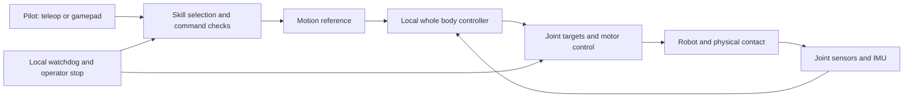

# European Robot Fighting League

A technical starting point for developers building a humanoid fighting league around Unitree G1 robots.

The recommended approach is a local, proprioceptive whole body controller with a small set of tested skills. Start with SONIC and teleoperation to establish a working baseline. Adapt the controller for contact and recovery, then let a pilot select skills with a gamepad. The robot handles balance and execution; the pilot handles tactics.

This first version is a design guide and reading collection. It does not contain a trained fighting policy. Sources and release status were checked on 21 October 2026.

## Start with a stable G1

Use a G1 configuration supported by the chosen checkpoint. NVIDIA's released SONIC controllers target the 29 degree of freedom G1; a different actuator configuration needs an explicit adaptation. Keep the model, observation configuration, encoder, decoder and control gains together. [SONIC models and deployment](https://github.com/NVlabs/GR00T-WholeBodyControl)

First reproduce standing, walking, turning and a few simple reference motions in simulation. Then reproduce the same commands on one robot in a controlled test area. Add the second robot only after both pass independently. Record sensor inputs, policy outputs and commanded joint targets so a failed motion can be traced to a particular part of the system.

Publish the robot configuration, checkpoint, deployment settings and repeated trial results as the baseline.

*SONIC method overview, NVIDIA and the SONIC authors. The control decoder turns motion intent and robot feedback into actions. [Paper and project](https://nvlabs.github.io/GEAR-SONIC/).*

## Keep control on the robot

Run the motor policy locally from joint states, IMU measurements and the action history required by its checkpoint. Proprioception closes the balance loop; the pilot supplies opponent awareness. Autonomous targeting would require additional sensing and estimation.

Start with teleoperation for testing and demonstrations. Move to gamepad commands to reduce dependence on continuous pose transmission and headset tracking. Both interfaces need measured latency, command expiry and a tested response to connection loss.

## Train for contact and recovery

A motion tracker is already a feedback controller. However, success on motions in free space does not establish success when a foot is blocked, an arm hits a target or another robot pushes the torso.

Train with disturbances and padded targets, varying placement, mass, compliance and motion. Include missed contact, interruption and recovery. Allow deviation from the reference when balance requires it.

Treat fall prevention, controlled descent and getting up as separate capabilities. Training only from upright states, or terminating every episode at the first fall, does not teach recovery from the floor.

[GigaBrain WBC 0.5](https://shepherd1226.github.io/gigabrain-wbc-0.5/) is a useful research reference for interaction training and recovery. Its behavior world model predicts actions, state and feasible behavior commands. It is a different controller architecture, not a released SONIC LoRA recipe. Its reported recovery percentage is a simulation result; its hardware demonstrations provide separate evidence.

*Method overview from Cheng et al., GigaBrain WBC 0.5. The relevant design idea is conditioning execution on what the robot can physically do. [Paper](https://arxiv.org/abs/2608.18234).*

## Adapt the baseline with LoRA

Start adaptation from a working checkpoint. LoRA freezes base weights and learns small weight updates. For this project, decoder adapters are a candidate way to specialize control for the configured robot and contact curriculum while retaining the existing command interface.

[TRACE on Unitree H2](https://github.com/QinnyuLan/SONIC_unitree_h2) and the [SONIC transfer to AgiBot X2](https://sonic-agibot-x2.github.io/sonic-transfer/) provide concrete transfer examples. Their results motivate efficient adaptation; they do not establish a ready G1 fighting controller. Contact robustness must be trained and measured explicitly.

Compare adapters against the original checkpoint on locomotion, tracking, contact and recovery. Fewer trainable parameters do not guarantee proportionally less simulation time. [Adaptation and training](docs/training.md)

## Add skills with explicit transitions

Begin with stance, guard, stepping, turning and recovery. Add a punch against a padded target, then a kick. Jumping belongs later because takeoff, landing and interruption need their own validation.

A skill needs entry conditions, a reference, interruption points, completion criteria and a stable exit. Begin with one adapted controller conditioned on skills. Separate experts or adapters require tests at every switch.

| Pilot input | Proposed command |
| --- | --- |
| Left stick | Translation within the tested locomotion range |
| Right stick | Heading |
| Face buttons | Request a tested punch or kick |
| Shoulder button | Guard or cancel where the active skill permits it |
| Dedicated stop | Independent operator stop |

Reject incompatible moves, expire stale requests and prioritize recovery after a fall. These are proposed league commands, not SONIC defaults.

## Obtain reference motions

Use recorded demonstrations or existing motion datasets before generating a large custom library. For video, a practical route is **GVHMR → GMR or UMR → validated robot references → simulation training**. UMR is the method based on learned point cloud correspondence.

Video does not provide measured forces or guarantee feasible robot motion. Check geometry and dynamic execution after retargeting, preserving target locations and contact timing. [Motion preparation](docs/motions.md)

## Use mjlab for the training environment

We recommend mjlab and MuJoCo Warp for inspectable models, configurable contacts and GPU training. Calibrate the robot and padding against measurements. Solver choice alone does not establish better contact accuracy than PhysX.

SONIC's released training pipeline uses Isaac Lab. mjlab includes a G1 tracking task, but that task is not a SONIC implementation. Moving SONIC and its LoRA training into mjlab requires an observation, action, motion and learner integration. Reproduce the existing baseline before changing the simulator and adaptation method together.

mjlab provides SkyPilot templates for cloud training. Use AWS GPU workers, first checking execution and checkpoint recovery with a small job. [Training and AWS setup](docs/training.md)

## Validate the deployed controller

Test the exported policy with the robot's actual observations. If using distillation, measure degradation from teacher to student and export on the same trials.

Expose a validated **reference playback speed** for gradual testing. Action scale changes joint command magnitude; setting it to 0.3 does not make motion three times slower. Keep control frequency fixed and test slower reference timing separately, especially for dynamic movements. [Deployment checks](docs/deployment.md)

## Turn the controller into a league

REK provides a useful operational example of human pilots paired with learned robot balance and a simulator for pilot practice. Its collaborator describes a shared control experience across real and simulated fights. This supports the interface direction, but does not validate our proposed training stack. [REK engineering account](https://reflexarc.co.uk/projects/rek-robots)

The league also needs a common robot specification, command protocol, referee, replay logs, arena procedures and independent stops. Keep scoring separate from a policy's training reward. [League systems](docs/league.md)

| Milestone | Evidence needed before proceeding |
| --- | --- |
| One robot baseline | Repeated stance, locomotion and reference tests |
| Contact adaptation | Improved target and disturbance tests without baseline regression |
| Gamepad skills | Valid transitions, cancellation and disconnect behavior |
| Two robot simulation | Shared contact physics, valid scoring and repeatable evaluations |
| Controlled hardware trials | Tested containment, stop behavior and operator procedures |

[Papers, repositories and source status](docs/references.md)
