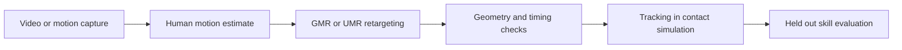

# Motion preparation

[Main guide](../README.md)

## Start with usable data

Existing robot references and recorded teleoperation are usually easier to validate than arbitrary video. [BONES SEED](https://huggingface.co/datasets/bones-studio/seed) is a starting collection; check the dataset and body model terms for the intended use. Record the source clip, robot model, sampling rate and processing settings with each motion.

## Recover motion from video

[GVHMR](https://github.com/zju3dv/GVHMR) estimates world grounded human motion from monocular video. Its output is a body motion estimate, not robot joint targets. [GMR](https://github.com/YanjieZe/GMR) includes a GVHMR conversion path and maps human motion onto supported humanoid models.

[UMR](https://github.com/hanyang9/UMR) is the point cloud based alternative. It learns surface correspondences and uses them in constrained retargeting. It is useful when morphology and interaction contacts matter beyond sparse joint matching. Its correspondence stage is reused for the same source template and robot.

These stages have different jobs. Retargeting finds compatible poses; simulation training learns how to execute them under dynamics. Neither reconstruction nor retargeting establishes real contact forces.

## Prepare a skill

1. Inspect reconstruction for occlusion errors, foot sliding, root drift and incorrect scale.
2. Check joint limits, self collision, floor penetration and reachable target placement.
3. Preserve timestamps and derive velocities consistently after resampling or retiming.
4. Include the approach, execution and return to stance, rather than extracting only the striking frame.
5. Represent the target or opponent in simulation. Label intended contact surfaces and timing; do not infer force from pixels.
6. Test the reference dynamically before adding it to the training set.

For mjlab, use its [motion preprocessing workflow](https://mujocolab.github.io/mjlab/v1.6.0/source/training/motion_imitation.html). For SONIC, use its own [training data workflow](https://nvlabs.github.io/GR00T-WholeBodyControl/user_guide/training.html). A shared file extension does not imply matching coordinates, joints or body indices.

Keep entire source clips or recording sessions in a single data split. Adjacent frames from one demonstration should not appear in both training and validation. Include failed contact and recovery trials in the evaluation report, not just successful tracking error.
